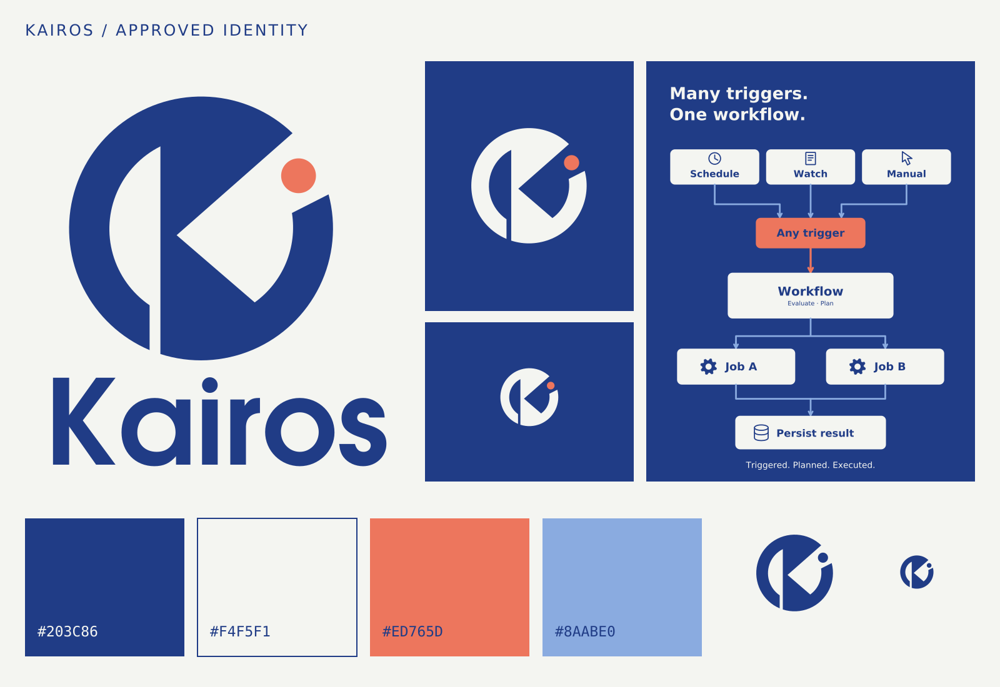

# Kairos artwork

The approved identity pairs the original circular K with cobalt and coral. The separate coral point marks the opportune moment; the supporting illustration shows Kairos's actual role: different triggers start one workflow, jobs execute, and results are persisted.

## Logo assets

| Application | Asset |
|---|---|
| Horizontal lockup | [SVG](brand/kairos-logo.svg) · [PNG](brand/kairos-logo.png) |
| Stacked lockup | [SVG](brand/kairos-logo-stacked.svg) · [PNG](brand/kairos-logo-stacked.png) |
| Primary symbol | [SVG](brand/kairos-mark.svg) · [PNG](brand/kairos-mark.png) |
| Reversed symbol and lockup | [Symbol](brand/kairos-mark-reversed.svg) · [Lockup](brand/kairos-logo-reversed.svg) |
| Monochrome symbol | [SVG](brand/kairos-mark-monochrome.svg) |
| Small optical symbol | [SVG](brand/kairos-mark-small.svg) · [PNG](brand/kairos-mark-small.png) |
| Wordmark | [SVG](brand/kairos-wordmark.svg) |
| Workflow illustration | [SVG](brand/kairos-orchestration.svg) · [PNG](brand/kairos-orchestration.png) |

SVG lettering is outlined and needs no installed fonts. The wordmark uses URW Gothic Demi shapes with a round i dot matching the approved concept. Documentation lettering uses outlined DejaVu Sans and DejaVu Sans Mono. Every SVG consists of vector paths and shapes, with an accessible title and description.

Use the reversed assets on a cobalt background. Use the small optical symbol at 16–32 pixels; it widens the lower slit and slightly enlarges the opportunity point. Leave at least one opportunity-point diameter of clear space around a logo. Scale proportionally.

## Palette

| Color | sRGB | Use |
|---|---|---|
| Cobalt | `#203C86` | Primary ink, wordmark, text |
| Porcelain | `#F4F5F1` | Light surface, reversed symbol |
| Coral | `#ED765D` | Opportunity point, selected accent |
| Mist | `#8AABE0` | Secondary connectors, supporting graphics |

Use cobalt on porcelain for body text. Coral and mist serve as accents. Palette files: [JSON](brand/kairos-palette.json), [CSS](brand/kairos-palette.css), [Krita/GIMP GPL palette](brand/kairos-palette.gpl), and [SVG swatches](brand/kairos-palette.svg).

## Editable source and diagrams

The [native Krita identity board](brand/source/kairos-brandboard.kra) contains editable vector artwork. Its [PNG companion](brand/source/kairos-brandboard.png) provides a preview. Individual exported SVGs are also editable vector sources.

The [main diagrams](diagrams/README.md) cover the architecture, unified execution pipeline, and parallel job execution. Original text alternatives remain in the README and authoring guide. File listings, directory trees, and smaller diagrams remain unchanged.
