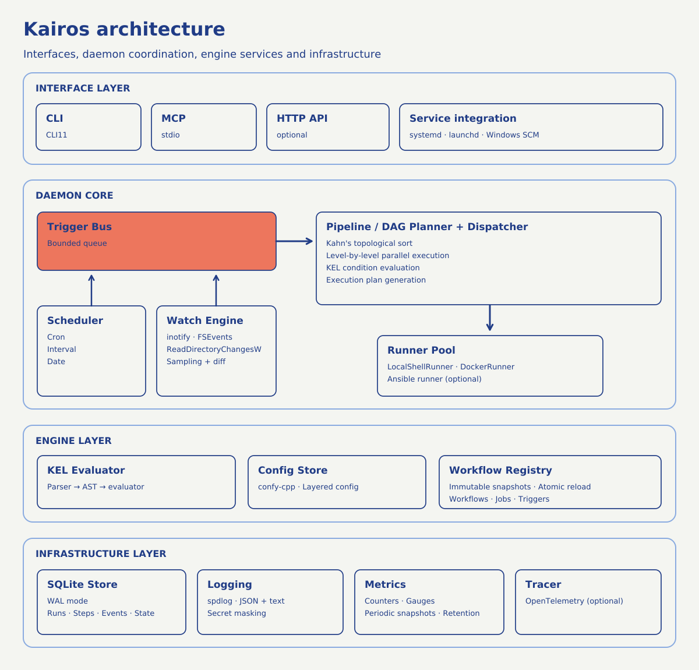

# Kairos documentation diagrams

3 unique diagrams recreate 3 source diagrams in the main architecture and execution sections of the repository guides. Each SVG was constructed on a vector layer and serialized by Krita 6.0.3. PNG previews are available alongside each SVG.

The [manifest](manifest.json) records the original source paths, sections, line numbers, and diagram text. File listings, directory trees, CLI output, and smaller diagrams remain in text in their original documents.

## Main diagrams

| Diagram | SVG | PNG | Source |
|---|---|---|---|
| Unified Pipeline | [SVG](repository/readme-unified-pipeline.svg) | [PNG](repository/readme-unified-pipeline.png) | `README.md` · original line 41 |
| Architecture | [SVG](repository/readme-architecture.svg) | [PNG](repository/readme-architecture.png) | `README.md` · original line 205 |
| Parallel Execution | [SVG](repository/authoring-parallel-execution.svg) | [PNG](repository/authoring-parallel-execution.png) | `Authoring.md` · original line 252 |
